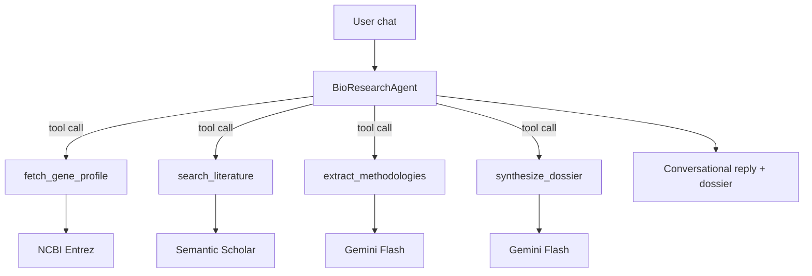

# Bio-Agent

[](LICENSE)

**Bio-Agent** is an open-source, conversational biomedical research assistant. Chat naturally to profile genes via NCBI, mine literature from Semantic Scholar, extract experimental methodology with Gemini, and synthesize executive dossiers with protocol conflict detection.

## Features

- **Conversational interface** — ask questions or request dossiers in plain English
- **Autonomous tool use** — the agent decides when to call NCBI, literature search, extraction, and synthesis tools
- **Live data** — NCBI Entrez, Semantic Scholar, Gemini (google-genai SDK)
- **Open source** — MIT licensed, fork-friendly Python codebase

## Architecture



## Quick start

```bash
git clone https://github.com/YOUR_USERNAME/bio-agent-dossier.git
cd bio-agent-dossier
pip install -r requirements.txt
cp .env.example .env
# Edit .env with your keys
streamlit run app.py
```

## Environment variables

```env
GEMINI_API_KEY=your_gemini_key
GEMINI_MODEL=gemini-flash-latest
GEMINI_SYNTHESIS_MODEL=gemini-flash-latest
NCBI_EMAIL=your_email@example.com
NCBI_API_KEY=your_ncbi_api_key
SEMANTIC_SCHOLAR_API_KEY=optional
```

> New Google AI Studio keys use the `AQ.` format and require the `google-genai` package.

## Example conversations

- "Build a dossier for VEGFA"
- "What does NCBI say about TP53?"
- "Find open-access papers on collagen hydrogel angiogenesis"
- "Compare experimental methods across VEGFA hydrogel studies"

## Project structure

```
bio-agent-dossier/
├── agent.py              # Conversational agent + Gemini function calling
├── tools.py              # Agent tools (NCBI, papers, synthesis)
├── state.py              # Session state
├── app.py                # Streamlit chat UI
├── ncbi_extractor.py     # NCBI Entrez module
├── paper_miner.py        # Semantic Scholar + methodology extraction
├── dossier_synthesizer.py
├── gemini_client.py      # Shared Gemini client
├── LICENSE
└── README.md
```

## Contributing

Contributions welcome! To contribute:

1. Fork the repository
2. Create a feature branch
3. Make your changes with tests where applicable
4. Open a pull request

## License

MIT — see [LICENSE](LICENSE).
